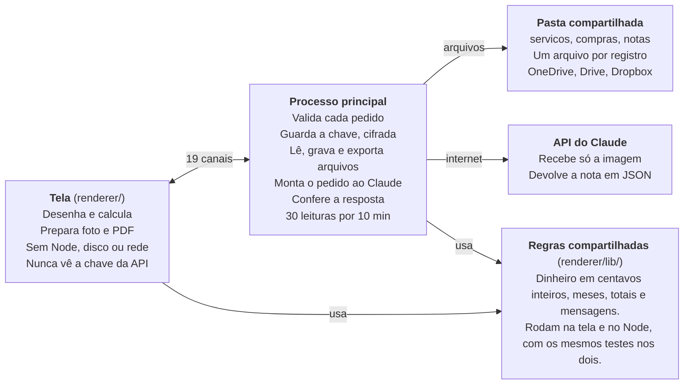
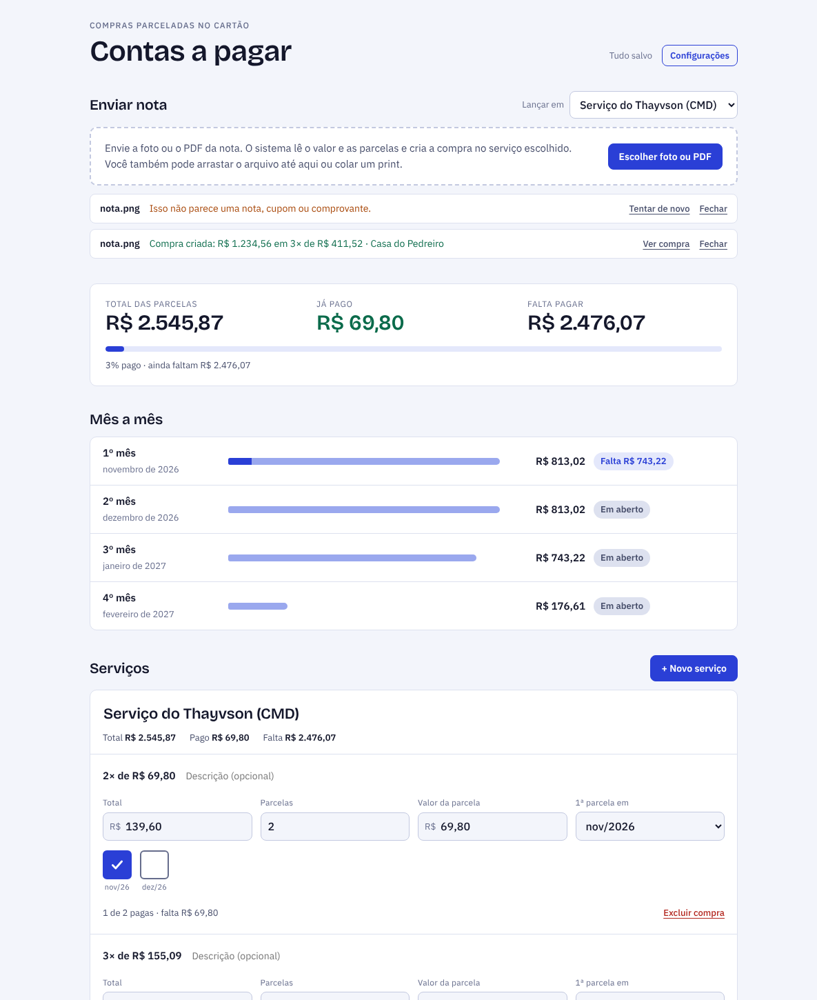
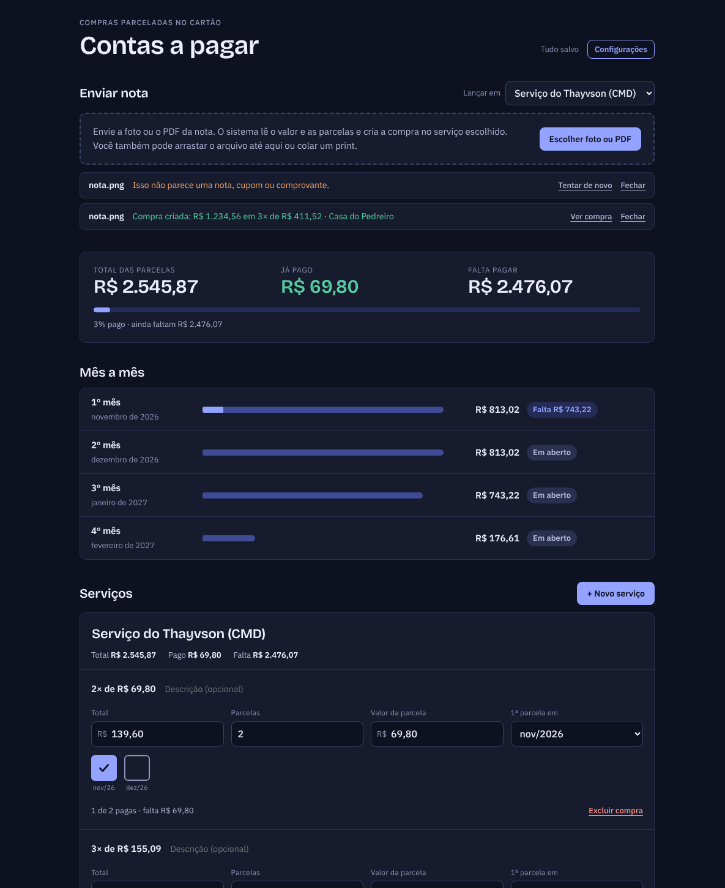

# Relatório do Projeto Contas a Pagar

26 de outubro de 2026, atualizado em 30 de outubro com a exportação para planilha. Esta é a cópia do relatório guardada no repositório; a versão com comentários fica no documento do projeto no Claude Docs.

## Resumo

O programa **Contas a Pagar** está pronto para instalar no Windows e no Mac. Ele controla as compras parceladas do cartão por serviço, mostra o valor de cada mês, guarda tudo numa pasta compartilhada entre 2 e 5 pessoas, lê foto ou PDF da nota com o Claude e exporta as parcelas para uma planilha (CSV) para o contador. O que falta eu não consigo fazer daqui: lê-lo com uma nota e uma chave reais.

- **Onde está:** ramo `contas-a-pagar-desktop` do repositório no GitHub. Os instaladores (`.exe` do Windows e `.dmg` do Mac) ficam na aba Artifacts da execução mais recente em [Actions](https://github.com/JoaoAndrade0/Alpha-Deluxe7/actions/workflows/contas-a-pagar-instalador.yml). O passo a passo está no [README](../README.md).
- **Testes:** 95 de unidade (99,5% das linhas), 42 verificações com o programa aberto de verdade e a abertura do programa empacotado no Windows e no Mac. Tudo verde na última execução do GitHub.
- **Segurança:** a tela não acessa disco, internet nem a chave da API; todo pedido é conferido no processo principal; as dependências não têm falha conhecida. Achei e corrigi 8 problemas, entre eles um leitor de PDF com falha de execução de código.
- **Design:** tema claro e escuro, hierarquia do caderno, 0 violações no axe-core, contraste mínimo de 4,7:1, uso só pelo teclado e zoom de 200%.
- **Ainda não provado:** nenhuma nota real foi lida (não há chave neste ambiente) e ninguém usou os instaladores, que não têm assinatura paga.
- **Decisão sua:** publicar em Releases (tag `contas-v1.0.0`) e juntar o ramo ao principal. Não fiz nenhum dos dois.

## Estrutura

O programa tem três camadas com fronteiras fixas: a tela só desenha, o processo principal guarda a chave e fala com o disco e com a API, e as regras de cálculo vivem em módulos puros usados pelos dois.



A tela só conversa com o processo principal por 19 canais fixos; só ele toca a pasta e a API do Claude, e as regras de cálculo são as mesmas dos dois lados.

- **Tela** (`renderer/`): ponte, preparo de foto e PDF, envio de nota, configurações e tela principal. Não lê disco, não acessa a internet e nunca vê a chave da API.
- **Processo principal** (`lib/`, `main.js`): dados em arquivos, configurações, leitura de notas pelo Claude, planilha para o contador, validação de tudo que chega da tela e limite de leituras.
- **Regras compartilhadas** (`renderer/lib/`): dinheiro em centavos, meses, totais e mensagens. Rodam no Node e na tela, e os mesmos testes cobrem os dois.
- **Dados**: um arquivo por serviço e por compra, mais as fotos e PDFs em `notas/`, dentro da pasta que os computadores já sincronizam.

```
contas-a-pagar-desktop/
  main.js, preload.js        janela, protocolo seguro, canais de comunicação
  lib/                       store, config, claude, nota, exportar, validar, limites
  renderer/                  tela (HTML, CSS e scripts sem bundler)
    lib/                     dinheiro, meses, calculo, mensagens
  test/                      testes de unidade e teste completo (e2e)
  build/icon.png             ícone
```

Decisões que moldam o projeto:

1. **Pasta compartilhada em vez de servidor.** Sem conta nova, sem custo fixo e com histórico de versões do próprio OneDrive, Drive ou Dropbox.
2. **Um arquivo por registro.** Duas pessoas editando compras diferentes nunca se atrapalham; na mesma compra, vale a última gravação.
3. **O pedido ao Claude e a conferência da resposta ficam no processo principal.** A tela só envia imagens, então não consegue usar a chave para outra coisa.
4. **Dinheiro sempre em centavos inteiros**, para nunca acumular erro de arredondamento.

## Design

A tela segue o caderno: primeiro o total, depois o mês a mês, depois cada serviço com os quadradinhos das parcelas, nos temas claro e escuro.





Capturas reais do programa aberto pelo teste automático (dados de exemplo): tema claro e tema escuro, topo da tela.

- **Hierarquia:** resumo (total, pago, falta) → "Mês a mês" com a barra de quanto já foi pago → serviços e compras.
- **Quadradinho de parcela:** o mesmo gesto do caderno. O mês fica escrito embaixo e a borda laranja marca parcela de mês que já passou.
- **Estado nunca só por cor:** os selos dizem "Pago", "Em aberto" ou "Atrasado · falta R$ 176,61", e cada parcela tem rótulo falado ("Parcela 2 de 4, dezembro de 2026, R$ 57,13: em aberto").
- **Nota lida pelo Claude:** a compra nasce com a faixa "Lido da nota. Confira antes de pagar", a miniatura da foto e o botão "Está certo". Dinheiro lido por máquina nunca entra no total sem aviso.
- **Planilha para o contador:** botão discreto ao lado de "Mês a mês" (só aparece quando há parcelas). O resultado ("Planilha salva como …" ou o motivo da falha) aparece escrito na tela e é anunciado por leitores de tela.
- **Fontes dentro do programa** (Bricolage Grotesque e IBM Plex Sans, licença livre): nada é baixado da internet ao abrir.

Acessibilidade, medida em 10 estados (tela principal, configurações, sem serviços, primeira abertura e erro de exportação, cada um nos dois temas):

| Verificação | Resultado |
| --- | --- |
| axe-core, WCAG 2.1 AA e boas práticas | 0 violações; a auditoria acusou uma violação plantada de propósito, então o zero vale |
| Teclado | 40 paradas do Tab, todas com anel de foco; parcela marca com Espaço ou Enter; exportar planilha só com Enter, com o foco ficando no botão; Esc fecha as configurações |
| Zoom de 150% e 200% | sem rolagem horizontal |
| Contraste dos textos secundários | mínimo de 4,7:1 (o exigido é 4,5:1) |
| Movimento reduzido | animações desligadas quando o sistema pede |

## Segurança

O programa lida com dinheiro e com uma chave paga, então parte do princípio de que a tela, os arquivos da pasta compartilhada e a resposta do Claude podem estar errados ou ser hostis. Cada defesa abaixo tem um teste que tenta quebrá-la.

| Ameaça | Defesa | Prova |
| --- | --- | --- |
| Código injetado na tela | Política de conteúdo sem eval, sem script em linha e sem endereços externos; todo texto entra como texto | Bateria de segurança: eval, script, imagem, quadro e fetch externos bloqueados |
| Tela tentando usar Node ou o disco | Isolamento de contexto, janela em sandbox, ponte com 19 canais fixos e argumentos conferidos no processo principal | 12 chamadas maliciosas recusadas, nada gravado |
| Ler arquivos fora do programa pelo protocolo interno | Caminhos resolvidos dentro de pastas fixas; lista fechada de arquivos do leitor de PDF; só 5 tipos de nota | 22 tentativas (`../`, `%2e%2e`, `%00`) falharam |
| Abrir sites ou janelas estranhas | Navegação travada; só console.anthropic.com abre no navegador | `window.open` e troca de endereço para 7 destinos: nada abre além do permitido |
| Pedir câmera, localização ou área de transferência | Todas as permissões negadas | Teste de permissões |
| Roubo da chave da API | Fica só no processo principal, criptografada pelo sistema (ou em arquivo só do usuário), nunca na tela, na pasta compartilhada ou no pedido ao Claude | Varredura da pasta e das respostas; permissão 600 do arquivo |
| Fórmula escondida virando ataque na planilha do contador, ou a tela gravando onde não deve | Textos que começam com `=`, `+`, `-` ou `@` ganham um apóstrofo; quebras de linha e caracteres invisíveis saem; o lugar do arquivo vem da janela do sistema, nunca da tela; só as 10 colunas combinadas são gravadas | 3 mil conjuntos de dados aleatórios, 6 defesas removidas de propósito (todas derrubaram um teste) e, com o programa aberto, caminhos mandados pela tela são ignorados |
| Gasto sem querer na API | O pedido é montado no processo principal; no máximo 2 leituras ao mesmo tempo e 30 a cada 10 minutos | A leitura 31 é recusada e a API recebe exatamente 30 pedidos |
| Dados quebrados ou maliciosos na pasta compartilhada | Tudo é normalizado ao ler (tipos, tamanhos, anos de 2000 a 2100, até 60 parcelas); `.html` e `.svg` em `notas/` não são servidos | Bateria de robustez: HTML, scripts, números absurdos, JSON inválido, arquivo de 300 KB |
| Resposta enganosa do modelo, inclusive texto escondido na nota | O pedido manda tratar o texto da imagem como conteúdo; a resposta é conferida campo a campo; a compra nasce marcada para conferir | 20 mil respostas aleatórias: sempre válidas ou recusadas com código |
| Programa adulterado depois de instalado | Não roda como Node, ignora `NODE_OPTIONS` e depuração, só carrega o pacote `app.asar` e confere a integridade dele | Leitura dos fuses; programa empacotado abriu no Windows e no Mac |
| Dependências e processo de construção | Versões fixas, auditoria sem falhas altas, ações do GitHub fixadas por hash, permissão mínima, Dependabot com espera de 14 dias, SHA-256 nas publicações | Fluxo do GitHub Actions |

Falhas que encontrei e corrigi nesta rodada:

- **Rede em segundo plano:** o Chromium consultava um servidor de atualização do Google e a tela baixava fontes do Google a cada abertura. Desliguei a rede em segundo plano e embuti as fontes.
- **Leitor de PDF vulnerável:** a versão 3.11.174 tem falha conhecida de execução de código por PDF malicioso. O programa agora usa a 6.4.299, e na página do Claude desliguei a execução de código embutido.
- **Electron com aviso de segurança:** atualizei da 44.7.0 para a 44.9.3.
- **Configuração com permissão aberta:** um arquivo que já existia com leitura liberada não era fechado. Agora vira "só o seu usuário" ao abrir.
- **Leitor de valores frouxo:** aceitava `1.234.56`, `1,` e até listas como `[5]`. Agora recusa o que não dá para ter certeza.
- **Pedido ao Claude vindo da tela:** uma tela comprometida poderia gastar a chave com qualquer texto. Agora a tela só envia imagens.
- **Política de conteúdo larga:** liberava estilo em linha e o Google Fonts. Removidos.
- **Datas absurdas nos dados** (ano 9999) podiam gerar listas enormes. Anos fora de 2000 a 2100 são descartados.

Riscos que ficam:

- **Instaladores sem assinatura paga.** O Windows e o Mac avisam na instalação. O arquivo SHA256SUMS.txt das publicações permite conferir o download.
- **Quem acessa a pasta compartilhada pode ler e alterar tudo.** O modelo é de equipe de confiança; o programa se protege de dados estranhos, mas não impede alteração.
- **Programa malicioso rodando como o mesmo usuário** consegue pedir ao sistema a chave guardada. A criptografia protege contra outros usuários do computador, não contra o seu.
- **A imagem da nota vai para a Anthropic** para ser lida. Nada mais sai do computador.
- **As variáveis de teste** (`ANTHROPIC_BASE_URL` e `CONTAS_USER_DATA`) também valem no programa instalado; só afetam quem já controla o computador.
- **A mesma compra editada por duas pessoas no mesmo instante:** vale a última gravação.

## Testes

São 95 testes de unidade e 42 verificações com o programa aberto de verdade, mais a abertura do programa já empacotado no Windows e no Mac, tudo rodando sozinho no GitHub a cada envio. Para procurar testes instáveis, rodei a bateria completa 8 vezes seguidas num mesmo computador: 336 verificações, nenhuma falha.

| Camada | O que cobre | Resultado |
| --- | --- | --- |
| Unidade (95) | dinheiro e meses; planilha CSV (formato, fórmulas, 3 mil casos aleatórios); totais do caderno (R$ 1.311,31); regras de edição; leitura da nota com 20 mil respostas aleatórias do modelo e 30 mil textos aleatórios no leitor de valores; validação do IPC; limite de uso; configuração e chave; dados em arquivos (simultâneo, cache, conflitos); SDK do Claude pela rede contra servidor local; ponte da tela | 95 de 95. Cobertura: 99,5% das linhas, 95,4% dos ramos |
| Funcional (14) | abrir com dados do caderno; marcar parcela; mudança vinda de outro computador; foto e PDF viram compra; nota inválida; exportar planilha (cancelar, gravar, lugar sem permissão); configurações; primeira abertura | passou |
| Segurança (11) | ataques descritos na seção anterior, inclusive a planilha | passou |
| Robustez (10) | dados hostis e quebrados; 300 compras (abre em 0,5 s); edição ao mesmo tempo que outro computador; exclusões; pasta inválida; trocar de pasta; "tentar de novo" sem duplicar; fechar e abrir | passou |
| Acessibilidade (7) | axe-core em 10 estados, teclado (inclui exportar), zoom, contraste | passou |
| Programa empacotado | abre, lê a pasta, não enxerga Node e não dá erro, no Windows e no Mac do GitHub | Windows: passou em todas as execuções. Mac: falhou uma vez (a 3ª execução: o programa não mostrou os dados a tempo ao abrir) e passou em todas as outras. Depois que reforcei a assinatura de dados não falhou mais, mas pode ser intermitente |
| Revisão de código independente | 10 apontamentos sobre cancelamento, troca de pasta, cálculo de parcela, ordem de leituras, repetição, desempenho, mês de pagamento, PDF, README e teste de chave | os 10 foram corrigidos e têm teste |

Problemas que os próprios testes pegaram e que já foram corrigidos:

- Digitar o total e logo em seguida as parcelas deixava `parcelas = 3` com a parcela de R$ 900,00 (cálculo feito com o total antigo). Hoje toda edição enxerga as anteriores, mesmo as ainda sendo gravadas.
- O arquivo de configuração de quem já tinha o programa ficava com permissão aberta.
- O leitor de valores aceitava formatos misturados (`1.234.56`) e listas.
- Cancelar uma leitura durante a preparação da imagem ainda gastava a API.
- Trocar para uma pasta inválida esquecia a pasta que funcionava.
- Mudar o número de parcelas apagava a parcela digitada à mão.

Os testes completos também guardam capturas de tela dos dois temas e dos estados vazio e de primeira abertura em cada execução do GitHub (aba Artifacts).

## Limites e próximos passos

O que ainda não está provado, dito sem enfeite:

- **Nenhuma nota real foi lida.** A leitura foi testada com o SDK oficial falando com um servidor local que imita a API, e com 20 mil respostas aleatórias. Nunca rodou com uma chave de verdade nem com uma nota de verdade (este ambiente não tem chave). A precisão do Claude em notas suas ainda é uma incógnita; por isso toda compra lida nasce marcada para conferir.
- **Ninguém usou os instaladores.** No Windows e no Mac o GitHub gera o instalador, abre o programa empacotado, lê uma pasta e fecha. Isso prova que o pacote é válido, não que a experiência de instalar e usar está boa.
- **A planilha nunca foi aberta num Excel de verdade.** Está testado que o arquivo volta exatamente igual ao que foi escrito (ponto e vírgula, vírgula nos centavos, acentos em UTF-8 com a marca para o Excel). Com o Excel em inglês, `1234,56` pode ser lido como 123456: nesse caso, importe escolhendo ponto e vírgula e o português do Brasil.
- **Instaladores sem assinatura paga.** O Windows mostra "O Windows protegeu o computador" e o Mac pede clique direito > Abrir.
- **PDF com imagens JPEG 2000** não foi testado; notas térmicas longas ou fotografadas de longe podem sair ilegíveis.
- **Sem atualização automática:** para atualizar, instala-se a versão nova por cima.
- **Mesma compra editada por duas pessoas no mesmo instante:** vale a última gravação. Quem tem acesso à pasta compartilhada lê e altera tudo.

Próximos passos que eu sugiro, em ordem:

1. Instalar num computador seu e enviar uma nota real com a sua chave. Se a leitura errar, o ajuste é só no pedido ao Claude, que fica em um arquivo (`lib/nota.js`).
2. Lançar no programa as compras que já estão no caderno e na versão web.
3. Abrir a planilha exportada no Excel ou no Google Planilhas do seu contador e dizer se falta alguma coluna (por exemplo, um total por mês).
4. Assinar os instaladores e ligar a atualização automática, se o uso virar rotina.

Para publicar os instaladores em Releases, com o arquivo de conferência SHA-256, basta criar a tag `contas-v1.0.0`. Eu não fiz isso: espero a sua confirmação.
